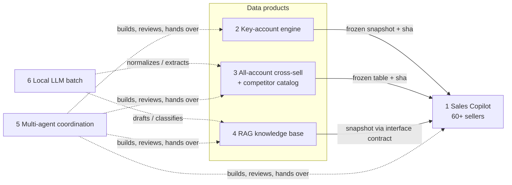

# AI PM Portfolio

Six AI products and systems I designed and shipped inside a bioreagent company in 2026, written up from a product manager's point of view: the problem, the users, the solution and its trade-offs, the results, and my role.

All company, customer, colleague and infrastructure details are removed. Examples use synthetic data. Code in this repository is illustrative skeleton or pseudocode, not production code.

## The projects

| # | Project | One-line positioning | Status |
|---|---|---|---|
| 1 | [Sales Copilot](projects/01-sales-assistant/) | Chat assistant inside the company messenger: a hosted LLM agent orchestrates our own MCP tools; a signed identity token decides what each seller may see. | Live for 60+ sellers |
| 2 | [Key-account recommendation engine](projects/02-key-account-recommender/) | Rule engine that turns each key account's drug pipeline (targets, modalities, stages) into a ranked "what to offer" list, with a regression golden set, QA and a rule log. | In production as the main data source behind project 1 |
| 3 | [All-account cross-sell & competitor catalog](projects/03-cross-sell-and-competitor-catalog/) | Extends recommendations to every account and builds a competitor catalog with "agent scouts once → scripts crawl → local LLM normalizes → human spot-checks". | Delivered as versioned frozen tables to project 1 |
| 4 | [RAG knowledge base](projects/04-rag-knowledge-base/) | Internal product knowledge ingested with evidence boundaries (source, version, conflicts) and a "do not guess" contract, plugged into the assistant. | Pilot snapshot delivered; integration in progress |
| 5 | [Multi-agent coordination system](projects/05-multi-agent-coordination/) | About seven AI coding-agent sessions (one dispatcher, five builders, one auditor) plus a second coding agent, coordinated through files, ownership rules and hard guardrails; humans run every production change. | Running daily; used to build and maintain projects 1–4 |
| 6 | [Local LLM batch processing](projects/06-local-llm-batch/) | A local 27B open-weight model for bulk extraction and classification, so sensitive rows never leave the machine; template-first, LLM as fallback, lock-based scheduling. | Running as shared infrastructure |

## What ties them together

- **One engine, several front ends.** Each data product hands a frozen, hash-pinned version to a single question-answering backend; the chat front ends only call its API. Nobody edits someone else's output directly.
- **Evaluation before rollout.** Every release passes a fixed question set and a strict judge before a human runs the deploy command. Failures are classified (real regression vs. environment) before anyone decides.
- **Data boundaries are product decisions.** Tools return summaries and counts; raw order or contact rows stay with local scripts and a local model. Out-of-territory users get counts, not details.
- **Humans own irreversible actions.** Agents propose; production deploys, server changes and messages sent in my name are executed by me, with a one-line command, the expected output and a rollback.

## My role

Product owner and system designer for all six. I defined the problems with sellers and product-support scientists, set scope and priorities, wrote or approved every spec and decision, and ran every production change. Implementation was done by AI coding agents (Claude Code and Codex) working under the coordination system in project 5; I reviewed their output against acceptance criteria rather than writing most of the code myself.

## Repository map

- `projects/<n>-*/README.md` — one write-up per project
- `projects/<n>-*/skeleton/` — de-identified skeletons and pseudocode
- [`RESUME_SUMMARY.md`](RESUME_SUMMARY.md) — one-page project summary with resume bullets
- [`docs/deidentification.md`](docs/deidentification.md) — what was removed and how it was checked
