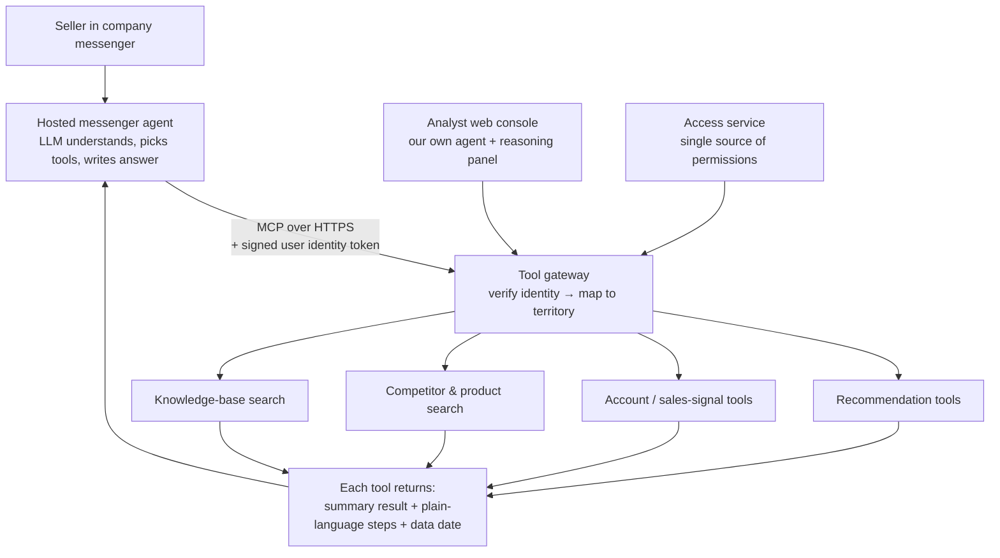

# Sales Copilot — AI Sales & Product-Support Assistant

> A chat assistant inside the company messenger. A hosted LLM agent understands the question and orchestrates our own MCP tools; a signed identity token decides what each seller is allowed to see. Opened to 60+ sellers in 2026.

## Problem

Sellers and product-support (PD) staff needed answers that lived in four different places: a recommendation engine, sales-signal reports, a competitor catalog and internal product notes. Getting "what should I bring to this account, and why" meant asking an analyst or digging through spreadsheets. Questions were messy and open-ended ("how is account X doing?"), and the answer had to respect territory: a seller may only see detail for their own region.

## Users

| User | Job to be done |
|---|---|
| Field sellers | Prepare for an account: what changed, what to offer, which products fit the account's pipeline |
| Product-support scientists | Answer product and application questions with a traceable source |
| Sales managers | Region-level views: rankings, changes, opportunities |
| Admin (me) | Monitor quality, act as a user for testing, roll out and roll back |

## Solution

Two "brains", one tool layer:
- **In the messenger**, the platform's own LLM agent does the orchestration. We only provide the tools and a persona prompt (capped at a few thousand characters by the platform).
- **In the analyst console**, our own agent orchestrates and shows a full reasoning panel.

Both call the same tools with the same authorization, so behaviour is consistent and tested once.

## Key decisions and trade-offs

| Decision | Alternatives considered | Why |
|---|---|---|
| **Let the messenger's hosted LLM orchestrate; we ship only tools** | Build our own bot with step-by-step cards | Faster to ship, no bot infrastructure to run, and sellers already live in the messenger. Cost: we cannot control how the UI shows reasoning, so every tool returns plain-language "steps for the user" and the persona asks the agent to end with a "How I found this" section. |
| **Split one ~40-tool server into several smaller tool servers** | Keep one large server | One change forced re-acceptance of everything (several versions in two days at one point) and the tool list alone was roughly 40 KB of context per turn. Splitting lets each tool group ship, roll back and be tested on its own. |
| **Identity from a token signed by the messenger, mapped to territory by one access service** | Per-user access codes typed into chat | Users authorize once; nothing secret is pasted into prompts. The tool servers only verify signatures and never store secrets. |
| **Data boundary: tools return summaries and counts; out-of-territory requests get counts only** | Return raw rows and let the LLM filter | Raw order or contact rows never enter an LLM context. A seller can learn that an opportunity exists elsewhere without seeing its details. |
| **"Show the reasoning wherever we can", but no internal names** | Hide the process; or expose raw tool output | Trust comes from seeing where an answer came from. A strict judge fails any answer that leaks a tool or table name. |
| **Admit gaps instead of guessing** | Always answer | Each tool distinguishes "not in this snapshot" from "no evidence"; the agent says so and suggests the next question. |

### Handling messy questions

Rather than trying to enumerate every question, the backend treats a question as a point in a space of dimensions (intent × object × metric × time × filter × output), each with an "unspecified" value filled by stated defaults. Illegal combinations are corrected or turned into one clarifying question. The test set is built pairwise across dimensions, so a few hundred questions cover every pair of values instead of tens of thousands of combinations. Multi-turn state is a structured query object (object, metric, time, filters), updated per turn, not a re-read of the whole transcript.

## Results

- **Rollout:** opened to **60+ sellers** across regions.
- **Quality gate:** a fixed **~25-question regression** run on the live configuration before each release. The last release passed **over 90%** on the original rubric and **about 85%** on a stricter judge that fails any answer mentioning an internal tool name; the gap became the next release's work item.
- **Scale of the tool layer:** grew from **~40 to 50+ tools** across recommendation, account signals, competitor and product search, and knowledge search.
- **Release discipline:** every server change shipped as a pinned package with a read-only pre-check, a check-only run, an independent code audit and a one-line rollback; I executed each deploy myself.

## My role

Product owner. I defined users and the territory/permission model, chose the "hosted LLM orchestrates, we ship tools" approach, set the data-boundary rule, wrote the persona and acceptance rules, decided what shipped in the first rollout (the stable release, with known gaps disclosed in the launch deck rather than claimed as fixed) and ran every production deploy. Backend, tool servers and packaging were implemented by AI coding agents coordinated as described in [project 5](../05-multi-agent-coordination/).

## Skeleton

- [`skeleton/tool_response.py`](skeleton/tool_response.py) — shape of a tool response with plain-language steps, data date and a territory gate (synthetic data)
- [`skeleton/identity.py`](skeleton/identity.py) — pseudocode for verifying a signed identity token and mapping it to a territory
