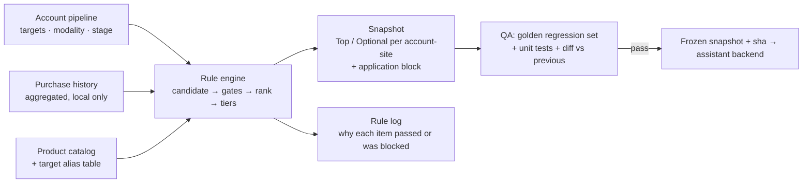

# Key-Account Recommendation Engine

> A rule engine that turns each key account's drug pipeline (targets, modalities, development stages) and purchase history into a ranked "what to offer" list, with a regression golden set, QA reports and a per-item rule log. It is the main data source behind the [sales assistant](../01-sales-assistant/).

## Problem

For the company's most important accounts, the right product to offer depends on science, not just past purchases: which targets the account is working on, in which modality (antibody, cell therapy, etc.), at which stage, and which of our reagents fit that work. Sellers did this by hand and inconsistently. A pure "customers who bought X also bought Y" model would miss new programs and would recommend things that make no scientific sense.

## Users

- **Sellers** preparing for a key account — consume the list through the assistant.
- **Product-support scientists** — check why an item was recommended.
- **Me, as product owner** — decide rule changes and approve each snapshot.

## Solution

- **Candidates** come from matching pipeline targets to catalog products through a curated alias table (one target can have many names).
- **Gates** remove items that do not make sense (wrong species for the context, membrane-protein duplicates across platforms, items explicitly out of scope).
- **Ranking and tiers**: each account-site gets a short **Top** list and a longer **Optional** list, with per-category caps so one product family cannot crowd out the rest. Every item carries an application block (one of eight application areas) so front ends can group results without recomputing.
- **Rule log**: every item records which rules it passed or failed. That makes "why is this here / why is this missing" answerable.

## Key decisions and trade-offs

| Decision | Why |
|---|---|
| **Rules first, learning later** | Sellers must be able to ask "why". With little labeled feedback, transparent rules plus a rule log beat an opaque model. Feedback from the assistant is collected to tune rules over time. |
| **Every rule change gets an impact estimate before it is built** | Example: lifting a species restriction looked like a one-line change. The impact analysis found the restriction was enforced in four separate places; removing only two would have released almost nothing. Together they affected ~11k items across ~1.5k rows, and only a few dozen would reach the Top tier. That turned a vague request into five concrete questions I could decide. |
| **Discontinued products: still recommended, clearly labeled** | Hiding them loses real opportunities (custom production is possible); showing them unlabeled misleads. Label: "discontinued, may need custom production". |
| **Snapshots are frozen and hash-pinned; only the backend owner swaps them in** | An early incident: a new snapshot was pushed straight into the live backend and broke ~500 alias links. After that, the engine only delivers "snapshot + hash + QA verdict" and the backend owner integrates it. |
| **Decisions go to me as structured cards** | Each open question is written as a card: what it is in plain words, the effect with units (items vs. rows vs. product codes), 2–4 options with consequences, a recommendation and rollback. This removed a recurring failure where counts in different units were compared. |

## Results

- Current frozen snapshot: **~2k rows and ~30k final recommendation items** for the key-account set, delivered with a hash and QA report.
- Regression discipline: golden regression set + unit tests run on every candidate; when a run showed a handful of failures among ~80 tests, they were classified (pre-existing vs. environment) before any decision, instead of blocking or ignoring them.
- Rule changes are now proposed with measured impact (items / rows / product codes) and approved as decision cards before a full build.

## My role

Product owner. I set the recommendation policy (what counts as a fit, what must never be recommended, how discontinued and species-variant products are handled), approved each rule change from its impact estimate, and approved every snapshot before hand-off. The engine, QA tooling and impact analyses were implemented by AI coding agents; the rule logic was reviewed by an independent auditing agent before release.

## Skeleton

- [`skeleton/rule_pipeline.py`](skeleton/rule_pipeline.py) — candidate → gates → rank → tiers with a rule log (synthetic data)
