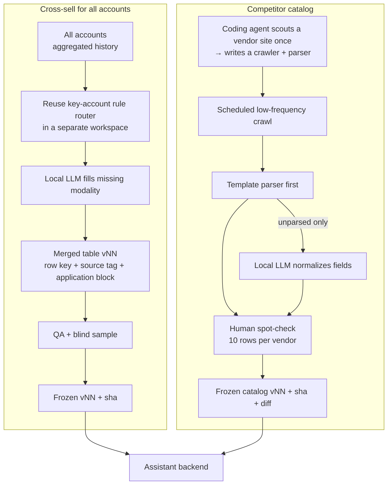

# All-Account Cross-Sell & Competitor Catalog

> Extends the key-account recommendation logic to every account, and builds a competitor product catalog with a pipeline of "an agent scouts each site once → scripts crawl on a schedule → a local LLM normalizes → a human spot-checks". Both ship to the assistant as versioned, hash-pinned frozen tables.

## Problem

1. The [key-account engine](../02-key-account-recommender/) covered only a curated set of accounts. Sellers spend most of their time on the long tail, where nobody had a "what to offer next" view.
2. Sellers kept asking "what does competitor X sell for this target, and at what price?" The answer lived on dozens of competitor websites in inconsistent formats.

## Users

- **Sellers** — cross-sell ideas for any account; competitor equivalents and list prices during a deal.
- **Product-support scientists** — matching a competitor product to ours by target and attributes.
- **The assistant backend** — consumes both tables as tools.

## Solution

## Key decisions and trade-offs

| Decision | Alternatives | Why |
|---|---|---|
| **Scout once, crawl with scripts, normalize locally** | Let an AI agent browse every vendor site on every refresh | The first design asked one agent to browse and fill fields each time. It was slow, expensive and not reproducible, and the launch scripts never ran correctly. Recurring data should not depend on an agent browsing; an agent writes the crawler once, then cheap scripts run it. |
| **Template parsing first, LLM only as fallback** | LLM-parse every page | Deterministic, free and auditable. In the latest batch, every page parsed by template and the LLM was not needed at all. |
| **Append-only versions with a row-level diff** | Overwrite the table | Each version must prove that previous rows did not change (0 changed / 0 deleted) and has 0 duplicate keys, so the backend can swap versions safely. |
| **"NOT FOUND" is a valid value** | Guess a target from the product name | In one increment of a few dozen new rows, about a third were mapped to a target by exact rules and the rest were left NOT FOUND rather than guessed. A wrong target in a sales conversation costs more than a gap. |
| **Scope limits set by policy** | Crawl everything | Some sources are excluded by decision (e.g. no bulk scraping of professional networks; some vendors out of scope). |
| **Key accounts stay with the key-account engine** | Merge both | Duplicate variant accounts for key accounts were excluded from the all-account table so the two products never contradict each other. |

## Results

- All-account cross-sell table at the ~**500k-row** scale, delivered to the assistant as a frozen, hash-pinned version.
- Competitor catalog: **~10k rows, ~30 columns**, built version by version; the latest increment added a few dozen rows with **0 changed and 0 deleted** existing rows, **0 duplicate keys**, and **100% of prices verified** against the captured source text.
- Daily crawl batches run unattended (latest: ~50 pages fetched, 0 failures).

## My role

Product owner. I defined what "a useful cross-sell row" and "a usable competitor record" contain, chose the scout-once / crawl / normalize / spot-check pipeline after the first design failed, set the sourcing limits, and approved each frozen version. Crawlers, parsers and QA were built by AI coding agents and checked by a separate reviewing agent.

## Skeleton

- [`skeleton/catalog_increment.py`](skeleton/catalog_increment.py) — template-first parsing with LLM fallback and an append-only version check (synthetic data)
