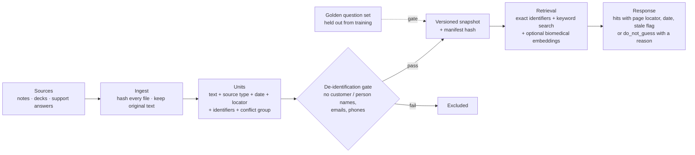

# RAG Knowledge Base with Evidence Boundaries

> Internal product knowledge (scientist notes, training decks, support answers) ingested with its evidence attached: source, date, version, page, and known conflicts. Retrieval follows a "do not guess" contract and plugs into the [sales assistant](../01-sales-assistant/) through a versioned interface.

## Problem

Product-support knowledge was spread across a shared notes vault (roughly 450 Markdown notes), training decks and chat threads. Some of it contradicted itself: one validation deck, for example, states two different detection limits on two different pages. A chatbot that blends these sources confidently is worse than no chatbot, because sellers repeat its answers to customers.

## Users

- **Sellers** asking product and application questions through the assistant.
- **Product-support scientists** who need the exact source and page to reply to a customer.
- **The assistant** — calls the knowledge tool and must know when *not* to answer.

## Solution

## Key decisions and trade-offs

| Decision | Why |
|---|---|
| **Keep originals; add an evidence layer on top** | Each unit records source type (official vs. internal note vs. support answer), date, stable link, page/slide and applicable conditions. Internal notes and official documents are never blended silently. |
| **Conflicts are returned, not resolved by the model** | Units that disagree share a conflict group; both claims come back, with the official source marked preferred. |
| **`do_not_guess` with three reasons** | "Not in this snapshot" (which does not mean the product does not exist), "no evidence", and "below confidence threshold". The assistant can then say precisely what it does not know. |
| **Degraded-first retrieval** | The production host had no numerical/ML runtime available. The baseline must pass the golden set with an embedded database alone (exact identifiers + full-text search + synonyms); biomedical embeddings are an optional add-on where they can be installed. A quantized embedding model was measured at roughly 250 MB resident and single-digit-millisecond p95 on a laptop; the full-precision one (600+ MB) was rejected as too large. |
| **Golden set is an exam, not a textbook** | Questions are written against held-out source units that never enter training exports; the export manifest must prove the overlap is empty. Only human-verified questions are "gold"; model-drafted ones are "silver" and are used for development only. The set includes leak tests: asking about content that is private to one person must return `do_not_guess`. Dev and test are split by source. |
| **Hard response budgets** | Snippets ≤ 300 characters, top-k 5 (max 8), each hit with a human-readable locator, so answers stay short and citable. Targets: tool process ≤ 600 MB; keyword p95 ≤ 1.5 s; with embeddings p95 ≤ 3 s, with automatic fallback to degraded mode on timeout. |
| **Separate project, contract-based integration** | The knowledge base is its own project with its own sessions. It talks to the assistant only through a written interface (v0 → v0.1) and a handover folder, so either side can change internals without breaking the other. |

## Results

- **Source inventory:** ~450 notes registered with per-file hash, size and origin; integrity check passes on all of them.
- **Interface v0.1** agreed between the two projects: source ids by content hash, manifest hash in every response, conflict "preferred" flag, de-identification gate, freshness flags, latency and memory budgets.
- **Pilot snapshot** delivered and verified by the assistant backend; the assistant-side client is written and integration is in progress. Retrieval quality numbers are not yet measured on the locked test split, so none are claimed here.

## My role

Product owner. I set the evidence rules (what counts as official, how conflicts are shown), the "do not guess" policy, the golden-set rules (gold vs. silver, holdout, leak tests) and the de-identification gate, and I negotiated the interface between the knowledge-base project and the assistant. Ingestion, retrieval and evaluation tooling were built by AI coding agents.

## Skeleton

- [`skeleton/knowledge_contract.py`](skeleton/knowledge_contract.py) — response contract with conflicts, freshness and `do_not_guess` reasons (synthetic data)
- [`skeleton/golden_item.example.json`](skeleton/golden_item.example.json) — one synthetic golden question
