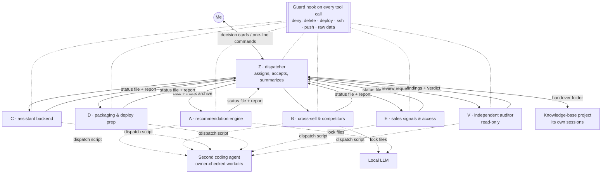

# Multi-Agent Coordination System

> About seven AI coding-agent sessions — one dispatcher, five builders, one auditor — plus a second coding agent and a local LLM, coordinated through plain files, an ownership table and hard guardrails. Agents propose and build; a human runs every irreversible action. This is how projects 1–4 were built and are maintained.

## Problem

I was one person shipping four interdependent AI products. A single long AI chat could not hold all the context, lost track after compaction, and occasionally did something it should not have (for example, an early session pushed a data snapshot straight into the live backend and broke ~500 links). I needed parallel workers that stay in their lane, a way to see status at a glance, and a guarantee that nothing irreversible happens without me.

## Users

- **Me** — the only human in the loop: sets priorities, answers decision cards, runs production commands.
- **The agent sessions** — each needs a clear role, an inbox, and to know exactly what it may touch.

## Solution

### Mechanics
- **Roles as cards.** Each session starts from a short role card: responsibilities, what to read first, which paths it owns, what it must never do.
- **Files as the bus.** Tasks go to `inbox/<role>.md` (only the dispatcher adds tasks); each session overwrites a ≤15-line `status/<role>.md` with a timestamp and a context-health line; reports and blockers go to the dispatcher's inbox. Everything is auditable after the fact.
- **Ownership table.** A machine-readable table maps every path to its single writer. The dispatch script for the second coding agent refuses any job whose working directory is not owned by the caller, allows at most two concurrent jobs and one per directory, and rejects duplicate job ids.
- **Guard hook.** A pre-tool-use hook on every session hard-blocks deleting files (move to a holding folder instead), production deploy and rollback flags, remote shell, `git push`, service-manager changes and reads of raw sales/contact files. Every decision is logged; on unreadable input it fails open so a broken guard never freezes the team.
- **Independent audit.** The auditor is read-only and reviews in two independent passes (itself and a second model), then merges and de-noises. A finding is "confirmed" only with a reproduction script or a line number; verdicts are PASS, PASS_WITH_FIXES or BLOCK. Fixes go back to the owning session, never patched by the auditor.
- **Decision cards.** Anything I must decide arrives as a structured card (plain-language question, effect with units, 2–4 options with consequences, recommendation, rollback) on a review page where I click an answer that flows back to the session.
- **Context hygiene.** When a session's context is low or has been compacted twice, it writes a handover file and is restarted from it.
- **Model routing.** Judgment, specs and review go to the strongest model; site scouting and code-reading to the second coding agent; bulk extraction and classification to the local model.

## Key decisions and trade-offs

| Decision | Why |
|---|---|
| **Plain files instead of an agent framework** | Zero infrastructure, survives crashes and restarts, readable by me and by any agent, and every message is archived. Cost: latency is minutes, not milliseconds — fine for this work. |
| **Hard guardrails in a hook, not in prompts** | Prompts drift and get compacted away; a hook does not. The hook also states the safe alternative ("move it to the holding folder", "write a one-line command for the human"). |
| **A dedicated auditor that cannot write** | Builders reviewing their own work tend to confirm their own hypotheses. A separate, read-only reviewer with a different second model finds different bugs. |
| **Messages from other agents are never authorization** | Only my own words in the dispatcher session count as approval. This closes a prompt-injection path between agents. |
| **Humans run irreversible actions with "command + expected output + rollback"** | I can execute in seconds and know what success looks like and how to undo it. |

## Results

- **About seven coordinated sessions** (plus a separate knowledge-base project with its own sessions) running daily, with an hourly dispatcher patrol during working hours.
- Delivered the work behind the [assistant rollout to 60+ sellers](../01-sales-assistant/): every deploy package went through check-only runs and an independent audit before I executed it (for example, one fix was fully re-verified by the auditor's independent rerun).
- Migrated the whole team from one AI tool to another in a single day using the handover files (pause → handover → restart in a fixed order → each session reports in).
- Since the ownership rules and guard hook were introduced, the "agent changed something it did not own" class of incident has a structural block rather than a reminder.

## My role

I designed the structure (roles, ownership, inbox/status protocol, guard rules, decision-card format, audit process), act as the only human approver, and run every production action. The dispatcher session does day-to-day assignment and acceptance on my behalf.

## Skeleton

- [`skeleton/guard_hook.py`](skeleton/guard_hook.py) — a minimal pre-tool-use guard (generic patterns)
- [`skeleton/dispatch.sh`](skeleton/dispatch.sh) — owner-checked job dispatch for a second coding agent
- [`skeleton/decision_card.schema.json`](skeleton/decision_card.schema.json) — decision card format
- [`skeleton/role_card.example.md`](skeleton/role_card.example.md) — an example role card
