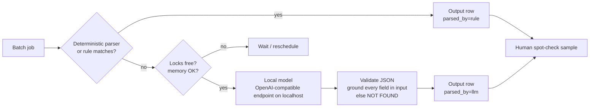

# Local LLM Batch Processing

> A 27B-parameter open-weight model served on a local workstation for bulk extraction, normalization and classification. Sensitive rows never leave the machine; deterministic code runs first and the model is the fallback; two projects share it through simple lock files.

## Problem

Several pipelines needed "read messy text, return clean fields" at volume: filling missing modality for hundreds of thousands of account rows, normalizing competitor product pages, drafting candidate evaluation questions, reviewing recommendation items. Sending that to a cloud model raised two issues: some inputs were derived from internal sales data that must not leave the company's machines, and per-token cost at this volume was hard to justify for repetitive work.

## Users

- **Pipeline owners** (the recommendation, cross-sell, competitor-catalog and knowledge-base workstreams).
- **Me**, deciding which work may use which model.

## Solution

- **Serving:** the model runs behind an OpenAI-compatible endpoint on localhost in two profiles: a speed profile with a 64K context and a quality profile with a 32K context.
- **Scheduling:** before any run, a job checks running processes and free memory, then requires two lock files to be empty (one per project, because two projects share the machine). It writes the shared lock, and on completion renames it to a "released by <who> at <time>" record instead of deleting it, which leaves an audit trail.
- **Routing policy:** raw or sensitive rows → local model only. Public web text → local model by default. Judgment, specs and code review → strongest cloud model. Code and site scouting → a cloud coding agent.

## Key decisions and trade-offs

| Decision | Why |
|---|---|
| **Template/rule first, LLM as fallback** | Cheaper, deterministic and auditable. When templates cover a source fully, the model is not called at all (latest competitor batch: 50 of 50 pages by template). |
| **Every model field must be grounded in the input** | Values that cannot be found in the source text become NOT FOUND; prices, for example, are checked against the captured text. This prevents fluent but invented values. |
| **Model output is "silver", never "gold"** | Model-drafted evaluation questions are for development only; acceptance always uses human-verified items. |
| **Locks as files, released by rename** | No scheduler to run or break; any session and the human can see who holds the model; the history is kept. |
| **Local quality is good enough for narrow tasks, not for open judgment** | The local model normalizes and classifies; it does not make product decisions or write customer-facing answers. |

## Results

- Shared by two projects and several workstreams with no scheduler service; every hold and release is kept as a lock record.
- Sensitive inputs for bulk tasks stay on the local machine by design; only aggregated, summarized results reach cloud models or the assistant.
- Measured throughput and cost-savings figures were not recorded in a form I can publish, so none are claimed here.

## My role

I set the routing policy (what may go to which model), the "rules first, model as fallback, ground every field" pattern and the lock protocol. Jobs were written by AI coding agents following that policy.

## Skeleton

- [`skeleton/local_batch.py`](skeleton/local_batch.py) — lock check, rule-first parsing, grounded LLM fallback (synthetic data)
